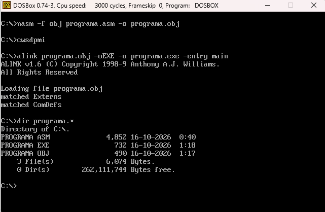
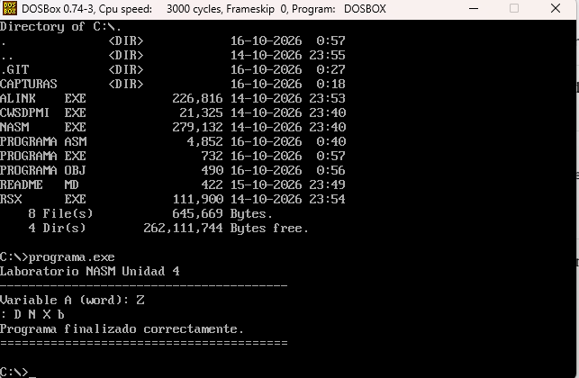
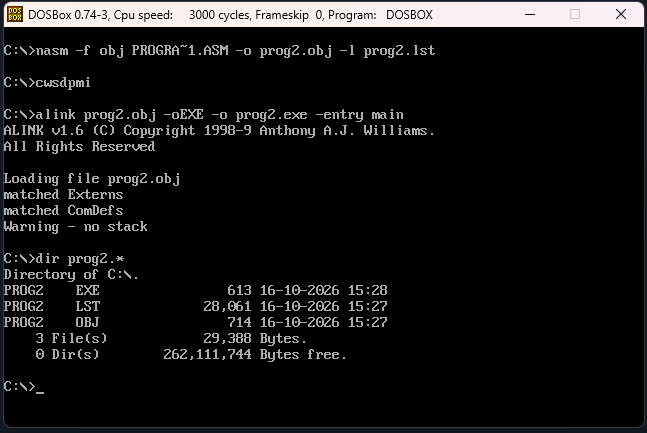
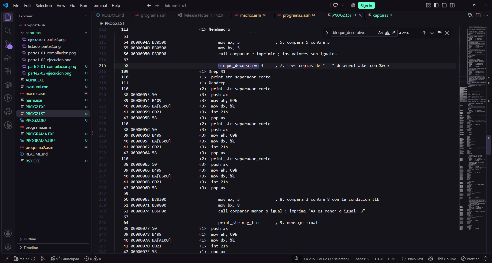
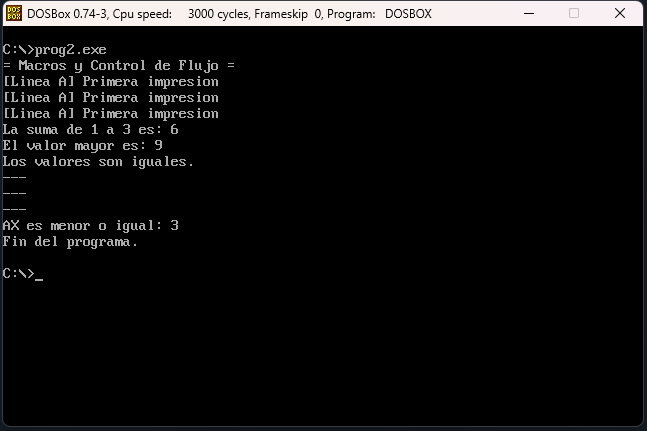

# Alferez-post1-u4

## Descripción

Laboratorio de la Unidad 4 (Arquitectura de Computadores): programa NASM con segmentos y salida por interrupciones DOS (Parte 1) y macros con control de flujo (Parte 2). En la Parte 1 se implementa un programa de 16 bits con las secciones `.data`, `.bss` y `.text`, constantes con `EQU`, inicialización del registro de segmento DS, salida con las funciones 09h y 02h de la interrupción 21h, un recorrido de tabla con `LOOP` y una línea decorativa generada con `TIMES`. En la Parte 2 se implementa un programa de 16 bits que separa las macros en `macros.asm` (incluido con `%include`) y las usa desde `programa2.asm`: macros con parametros y etiquetas locales (`%%`), una macro desenrollada con `%rep`, un bucle acumulador con `LOOP` y dos procedimientos de comparacion con `CMP`/`Jcc` (`JE`/`JG` y `JLE`).

## Prerrequisitos

- DOSBox 0.74 o superior
- NASM 2.14 o superior (`nasm.exe` en la carpeta de trabajo)
- ALINK (`alink.exe` en la carpeta de trabajo)
- `RSX.EXE` y `CWSDPMI.EXE` en la carpeta de trabajo: ALINK necesita un host DPMI para ejecutarse; sin él muestra el error `No DPMI-host found!`
- Editor de texto plano con codificación ASCII, sin BOM

## Compilación y ejecución — Parte 1

Dentro de DOSBox, con la carpeta de trabajo montada como `C:`:

```
mount C C:\ruta\de\tu\carpeta
C:
cwsdpmi
nasm -f obj programa.asm -o programa.obj
alink programa.obj -oEXE -o programa.exe -entry main
programa.exe
```

El comando `cwsdpmi` se ejecuta una sola vez por sesión de DOSBox, antes de `alink`.

## Estructura del repositorio

```
Alferez-post1-u4/
  programa.asm      ; Parte 1
  macros.asm        ; Parte 2: biblioteca de macros
  programa2.asm     ; Parte 2: programa integrador
  README.md
  capturas/         ; evidencia de ensamblado y ejecucion en DOSBox
```

## Salida esperada — Parte 1

```
Laboratorio NASM Unidad 4
----------------------------------------
Variable A (word): Z
: D N X b 
Programa finalizado correctamente.
========================================
```

Los caracteres de la tabla (`: D N X b`) resultan de sumar 30h a los valores 10, 20, 30, 40 y 50; no son dígitos porque los valores superan 9. La "Z" corresponde a 42 + 30h = 5Ah.

## Capturas — Parte 1

Ensamblado y enlazado exitosos, sin errores ni advertencias:



Ejecución en DOSBox, con la línea de 40 signos "=" después del mensaje final:



## Decisiones técnicas — Parte 1

### Decisión 1: `EQU` frente a `%define` para la constante de ancho

Para el ancho de la línea decorativa se selecciona `EQU` (`ANCHO_LINEA EQU 40`) y no `%define`. `EQU` crea un símbolo numérico que el propio ensamblador resuelve y verifica: el valor se evalúa una sola vez y una redefinición del mismo símbolo produce un error en lugar de pasar inadvertida. `%define`, en cambio, es una sustitución de texto que realiza el preprocesador antes de que NASM ensamble una sola instrucción; no entiende de números, solo reemplaza el nombre por el texto tal cual, y admite redefiniciones sin aviso. La diferencia importa porque `ANCHO_LINEA` se usa como argumento de `TIMES` y podría usarse en una comparación aritmética: con `%define ANCHO_LINEA 40+2`, la expresión `ANCHO_LINEA*2` se expandiría a `40+2*2`, es decir 44 por la precedencia de operadores, mientras que con `ANCHO_LINEA EQU 40+2` el símbolo vale 42 y `ANCHO_LINEA*2` da 84. Así, `EQU` evita los errores de sustitución de texto ambigua o mal formada. `%define` sí sería la opción adecuada para un fragmento de texto o de código que no es un valor numérico puro, como un alias de registro (`%define CONTADOR cx`) o una instrucción repetida literalmente (`%define LLAMAR_DOS int 21h`), casos que `EQU`, pensado para valores numéricos, no puede representar.

### Decisión 2: `TIMES` en `.data` frente a `RESB` con relleno en tiempo de ejecución

Para la línea de 40 signos "=" se recomienda `TIMES ANCHO_LINEA DB '='` en `section .data`. Frente a escribir manualmente los 40 caracteres dentro del literal `DB`, `TIMES` permite cambiar el ancho modificando un único número, sin contar caracteres ni arriesgar una línea de 39 o 41 signos. Reservar el mismo espacio con `RESB 40` en `section .bss` y llenarlo con un bucle `LOOP` sería una alternativa válida en principio, porque la salida en pantalla sería idéntica, pero resulta innecesaria aquí: el contenido de la línea es fijo, se conoce al ensamblar y nunca cambia entre una ejecución y la siguiente, por lo que no hay razón para construirlo cada vez; además habría que escribir también en tiempo de ejecución los bytes CR, LF y "$" finales. En el arranque, `TIMES` cuesta cero instrucciones, pues los bytes ya están en la imagen del ejecutable y DOS los carga junto con el programa. `RESB` más bucle exige inicializar CX y el puntero de destino y ejecutar unas 40 iteraciones de al menos tres instrucciones (escribir el byte, avanzar el puntero y `LOOP`), más de cien instrucciones en cada arranque. El costo de `TIMES` es que el archivo `.exe` ocupa algunas decenas de bytes más en disco, un precio mínimo; `RESB` con relleno solo sería preferible para buffers grandes o contenido que dependa de datos en tiempo de ejecución.

## Compilacion y ejecucion - Parte 2

Dentro de DOSBox, con la carpeta de trabajo montada como `C:`. DOSBox 0.74 solo maneja nombres de 8 caracteres, por eso `programa2.asm` aparece como `PROGRA~1.ASM`:

```
nasm -f obj PROGRA~1.ASM -o prog2.obj -l prog2.lst
cwsdpmi
alink prog2.obj -oEXE -o prog2.exe -entry main
prog2.exe
```

El archivo `macros.asm` debe estar en la misma carpeta, porque `programa2.asm` lo incluye con `%include`. La opcion `-l prog2.lst` genera el listado con las macros expandidas.

## Componentes - Parte 2

- `macros.asm`: `fin_dos`, `nueva_linea`, `print_str`, `print_char`, `leer_char`, `repetir_str` (con `%%ciclo`), `print_digito` y `bloque_decorativo` (con `%rep`).
- `sumar_serie`: suma 1+2+...+N con `LOOP`; `CX` se preserva con `PUSH`/`POP`.
- `comparar_e_imprimir`: decide con `JE` y `JG`.
- `comparar_menor_o_igual`: reutiliza las mismas macros, pero decide con `JLE`.

## Ajustes respecto al enunciado - Parte 2

- `print_str` guarda y restaura `AX` con `PUSH`/`POP`, porque la funcion 09h de `INT 21h` deja `AL = 24h` y eso destruia el valor que `print_digito` debia imprimir despues.
- `repetir_str` preserva `CX` con `PUSH`/`POP`, porque `LOOP` lo modifica.
- Se usa `mov ax, data` en lugar de `mov ax, @data`, porque `@data` es un simbolo de MASM/TASM que NASM no define (reporta `symbol '@data' not defined`); en formato `obj` el segmento se referencia por su nombre.
- El comentario de `jle` indica "menor o igual", ya que `JLE` salta tambien cuando ambos valores son iguales.

## Salida esperada - Parte 2

```
= Macros y Control de Flujo =
[Linea A] Primera impresion
[Linea A] Primera impresion
[Linea A] Primera impresion
La suma de 1 a 3 es: 6
El valor mayor es: 9
Los valores son iguales.
---
---
---
AX es menor o igual: 3
Fin del programa.
```

La suma 1+2+3 = 6 confirma que `LOOP` ejecuta exactamente 3 iteraciones. Las tres lineas `---` provienen de `bloque_decorativo 3`, y la ultima comparacion corresponde a `comparar_menor_o_igual` con AX = 3 y BX = 8.

## Capturas - Parte 2

Ensamblado y enlazado exitosos, sin errores ni advertencias:



Listado `.lst` con la expansion de `bloque_decorativo` (tres copias de `print_str` sin `CX` ni `LOOP`):



Ejecucion en DOSBox con la salida completa, incluidas las extensiones:



## Decisiones tecnicas - Parte 2

### Decision 3: `%rep` frente a `LOOP` para un numero de repeticiones fijo

Para bloque_decorativo se selecciona %rep, porque siempre se invoca con un numero pequeno y fijo de copias conocido al escribir el programa (por ejemplo 3). %rep es una directiva del preprocesador que duplica el codigo encerrado entre %rep y %endrep antes de que NASM ensamble una sola instruccion. Segun el listado .lst, cada copia de print_str ocupa 9 bytes de codigo maquina (push ax, mov ah, mov dx, int 21h y pop ax), de modo que 3 copias cuestan 27 bytes, un precio insignificante. Con 1000 copias el costo seria de 9000 bytes de codigo repetido, casi 9 KB para hacer siempre lo mismo, mientras que repetir_str ocuparia unos pocos bytes sin importar el conteo, porque solo cambia el valor cargado en CX. Si el numero de repeticiones fuera un valor leido en tiempo de ejecucion, por ejemplo capturado con leer_char, %rep no serviria: el preprocesador exige una constante conocida al ensamblar, y ese valor aun no existe cuando NASM trabaja. En ese caso repetir_str seria la opcion correcta, porque CX y LOOP deciden cuantas vueltas dar mientras el programa corre. El codigo expandido de repetir_str contiene push cx, mov cx, LOOP y pop cx; el de bloque_decorativo no contiene ninguno de ellos. Esa ausencia es el costo cero en tiempo de ejecucion de %rep: no hay inicializacion de CX, ni salto hacia atras en cada vuelta. El ahorro real es pequeno, porque la llamada a DOS domina el tiempo de cada impresion.

### Decision 4: etiquetas locales `%%` en `bloque_decorativo` y en `comparar_menor_o_igual`

La macro bloque_decorativo, tal como esta escrita, no necesita ninguna etiqueta porque su cuerpo solo repite print_str, que es una secuencia lineal de instrucciones sin saltos. Las copias se ejecutan una detras de otra, de arriba hacia abajo, y como la macro no define ninguna etiqueta, no existe ningun nombre que pueda repetirse entre invocaciones. Si se modificara para que un salto condicional interno omitiera la ultima copia, pasaria a necesitar %% en el momento en que el cuerpo incluyera un salto hacia una etiqueta propia, por ejemplo jz %%omitir y la definicion %%omitir:. La sola presencia de ese salto obliga a definir una etiqueta dentro de la macro, y cada invocacion copia el texto completo, de modo que sin %% todas las expansiones definirian el mismo nombre y NASM reportaria un simbolo duplicado a partir de la segunda invocacion. Con %% NASM genera un nombre distinto en cada expansion. En comparar_menor_o_igual las etiquetas con punto bastan porque un procedimiento se escribe una sola vez y CALL salta siempre a esa unica copia, sin expansion por invocacion. Ademas, una etiqueta con punto es local: NASM la une al ultimo nombre sin punto definido antes. Asi, .fin_cmp2 equivale a comparar_menor_o_igual.fin_cmp2 y .fin_comp a comparar_e_imprimir.fin_comp, nombres completos distintos que no colisionan.
